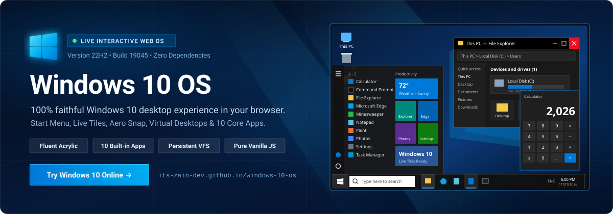
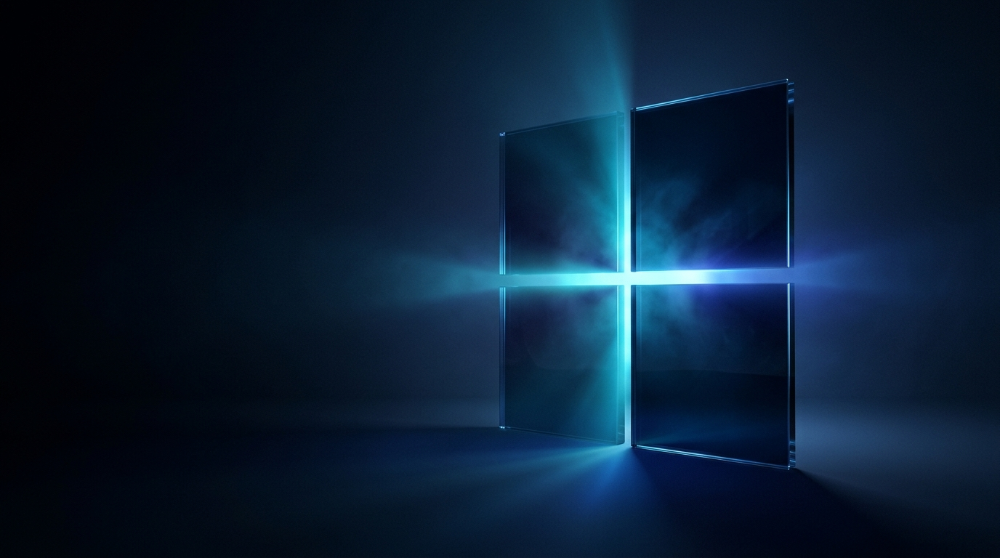
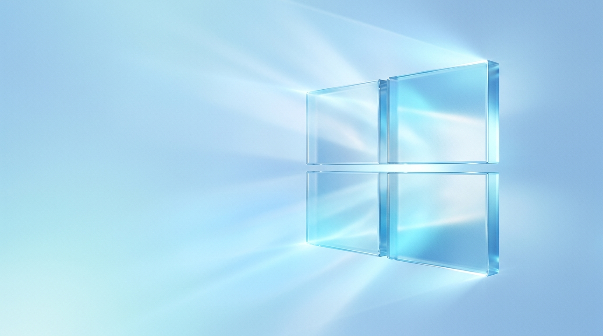

<div align="center">

<a href="https://its-zain-dev.github.io/windows-10-os/" target="_blank">
  
</a>

<br />
<br />

<a href="https://its-zain-dev.github.io/windows-10-os/" target="_blank">
  
</a>
&nbsp;&nbsp;
<a href="https://github.com/its-zain-dev/windows-10-os/stargazers">
  
</a>

<br />
<br />

[](https://its-zain-dev.github.io/windows-10-os/)
[](#tech-stack--architecture)
[](#tech-stack--architecture)
[](#tech-stack--architecture)
[](#tech-stack--architecture)
[](#10-built-in-core-apps)
[](#seo-first-engineering)
[](LICENSE)

<br />

<h3>A 100% faithful, pixel-accurate Windows 10 desktop OS running directly in your browser.</h3>

<p>
  Boot sequence • Spotlight Lock Screen • 3-Column Start Menu &amp; Live Tiles • Aero Snap &amp; Virtual Desktops • Action Center &amp; 6 System Flyouts • Persistent <code>C:\</code> Virtual File System • 10 Working Core Apps — with <strong>zero frameworks and zero build steps</strong>.
</p>

<p>
  <a href="#-live-experience">Live Experience</a> •
  <a href="#-visual-showcase">Visual Showcase</a> •
  <a href="#-complete-windows-10-shell">Shell Features</a> •
  <a href="#10-built-in-core-apps">Built-in Apps</a> •
  <a href="#-keyboard-shortcuts">Shortcuts</a> •
  <a href="#tech-stack--architecture">Architecture</a> •
  <a href="#-quick-start-local">Run Locally</a>
</p>

</div>

---

## 🚀 Live Experience

Anyone can boot into Windows 10 immediately — no downloads, no installs, no virtual machines:

> **🌐 Live URL:** **[https://its-zain-dev.github.io/windows-10-os/](https://its-zain-dev.github.io/windows-10-os/)**

1. **Boot Screen** — Authentic dotted-ring Windows 10 loader (click or press any key to skip instantly).
2. **Lock & Sign-In Screen** — Click, swipe up, or press any key to raise the Spotlight curtain, then hit **Sign in** (you can optionally configure a PIN in *Settings → Accounts*).
3. **Full Interactive Desktop** — Snap windows to edges/corners, create files on `C:\Users\User\Desktop`, switch themes & accent colors, open **Command Prompt**, draw in **Paint**, or press `Alt + X` for the Power User menu.

---

## 🖼️ Visual Showcase

Four bundled high-resolution authentic wallpapers power the desktop, light/dark modes, lock screen, and Photos gallery:

<table>
  <tr>
    <td align="center" width="50%">
      <a href="https://its-zain-dev.github.io/windows-10-os/">
        
      </a>
      <br />
      <strong>Classic Dark Hero Desktop</strong><br />
      <sub>Default dark Windows &amp; App mode with Fluent Acrylic transparency</sub>
    </td>
    <td align="center" width="50%">
      <a href="https://its-zain-dev.github.io/windows-10-os/">
        
      </a>
      <br />
      <strong>Windows 10 1903 Light Theme</strong><br />
      <sub>Instant toggle between Dark &amp; Light modes + 32 official accent colors</sub>
    </td>
  </tr>
  <tr>
    <td align="center" width="50%">
      <a href="https://its-zain-dev.github.io/windows-10-os/">
        
      </a>
      <br />
      <strong>Windows Spotlight Lock Screen</strong><br />
      <sub>Slide-up curtain, live clock/date, network &amp; power controls, optional PIN</sub>
    </td>
    <td align="center" width="50%">
      <a href="https://its-zain-dev.github.io/windows-10-os/">
        
      </a>
      <br />
      <strong>Alpine Spotlight &amp; Photos Gallery</strong><br />
      <sub>Browse, zoom, rotate, and set any picture as your live desktop wallpaper</sub>
    </td>
  </tr>
</table>

---

## 🪟 Complete Windows 10 Shell

Every signature detail of the Windows 10 desktop environment has been recreated down to the `0px` window corners, `40px` taskbar height, `#E81123` close-button hover, and dotted-ring spinner:

| Shell Subsystem | Authentic Capabilities |
| :--- | :--- |
| **Power & Lifecycle** | Boot loader, Sleep, Restart, Shut down, Lock, Sign-in with optional PIN, and realistic **BSOD** (`CRITICAL_PROCESS_DIED` stop code + QR code). |
| **Desktop & Icons** | Grid icon layout, drag-and-drop repositioning, marquee box selection, inline `F2` rename, `Delete` to Recycle Bin, Desktop right-click menu (*View*, *Sort by*, *Refresh*, *New Folder / Text Document*, *Personalize*). |
| **Window Manager** | Sharp `0px` Win10 chrome, `32px` titlebars, `46px` caption buttons, drag-down from maximized, **8-way edge/corner resizing**, **Aero Snap** (left/right halves, maximize top, 4-quadrant corner snap with translucent ghost preview), Cascade / Stacked / Side-by-Side layouts, and Show Desktop. |
| **3-Column Start Menu** | Expandable left hamburger rail (User, Documents, Pictures, Settings, Power), scrollable A–Z app list with letter jump overlay, and customizable **Live Tiles** (pin/unpin, resize tiles). |
| **40px Taskbar & Search** | Pinned & running apps with accent underline indicators, live hover thumbnail previews, right-click jump lists, small taskbar toggle, plus Windows Search with instant **live math evaluation** and app/file filtering. |
| **Task View & Switcher** | Full **Task View** overlay with multi-desktop **Virtual Desktops** (`+ New desktop`), plus classic translucent **`Alt + Tab`** window switcher. |
| **Action Center & 6 Flyouts** | Slide-in **Action Center** (notifications + collapsible Quick Actions + live brightness slider) and all 6 taskbar flyouts: **Calendar & Events**, **Volume Mixer**, **Wi-Fi / Network**, **Battery Power Slider**, **Keyboard Language (`ENG`)**, and **Tray Overflow**. |
| **System Dialogs & Audio** | Classic Win32 **Run** (`Alt + R`), **Winver**, **File Properties**, **Win+X Power User Menu** (`Alt + X`), Toast notifications, live Display Brightness & Night Light filters, and **Web Audio API** Windows 10 system sounds. |
| **Persistent Virtual FS** | Full `localStorage`-backed `C:\` filesystem (`Desktop`, `Documents`, `Downloads`, `Pictures`, `Music`, `Videos`, `Windows`, `Program Files`) with **Recycle Bin** restore metadata. |

---

## <a id="10-built-in-core-apps"></a>🧩 10 Built-in Core Apps

Curated, deeply functional core Windows 10 apps — all wired into the shared Window Manager, Theme Engine, Sound Synthesizer, and Virtual File System:

| App | Module | Highlights |
| :--- | :--- | :--- |
| **📁 File Explorer** | [`explorer.js`](js/apps/explorer.js) | Classic Ribbon UI (*Home / Share / View*), breadcrumb address bar, *This PC* storage meter, *Details / Medium / Large* views, live folder search, *Recycle Bin* restore/empty, full file/folder CRUD. |
| **⚙️ Settings** | [`settings.js`](js/apps/settings.js) | Working OS controls across *System* (Display brightness, Night Light, Sound, About), *Personalization* (Wallpapers, 32 official Accent Colors, Dark/Light Windows & App modes, Acrylic transparency, Lock Screen, Taskbar), *Network*, and *Accounts* (Username & PIN). |
| **📝 Notepad** | [`notepad.js`](js/apps/notepad.js) | Classic Win32 menu bar (*File, Edit, Format, View, Help*), Open/Save directly to the Virtual File System, Find & Replace, Word Wrap, Zoom %, line/column status bar. |
| **🧮 Calculator** | [`calculator.js`](js/apps/calculator.js) | Frameless Fluent UWP chrome, **Standard** & **Scientific** modes, memory registers (`MC`/`MR`/`M+`/`M-`/`MS`), slide-out navigation drawer, and calculation history. |
| **🌐 Microsoft Edge** | [`edge.js`](js/apps/edge.js) | Multi-tab Chromium Edge browser with New Tab speed dials, address/search bar, per-tab history (Back/Forward/Reload), bookmarks, and embedded browsing. |
| **💻 Command Prompt** | [`cmd.js`](js/apps/cmd.js) | VFS-integrated `cmd.exe` (`Version 10.0.19045.4651`) with command history (`↑`/`↓`), `dir`, `cd`, `mkdir`, `type`, `echo`, `del`, `tree`, `ipconfig`, `ping`, `systeminfo`, `tasklist`, `taskkill`, `cls`, `ver`, `whoami`, `color`, `start`, `bsod`, and `help`. |
| **📊 Task Manager** | [`taskmgr.js`](js/apps/taskmgr.js) | Live running **Processes** table with *End Task*, plus real-time animated HTML5 Canvas **Performance** graphs (CPU, Memory, Disk, Wi-Fi), Startup & Users tabs. |
| **🎨 Paint** | [`paint.js`](js/apps/paint.js) | Classic `mspaint` ribbon with Pencil, Eraser, Flood Fill bucket, Line, Rectangle, Ellipse, Eyedropper, brush sizes, 20-color palette, Undo stack, and **Save PNG** directly into `C:\Users\User\Pictures`. |
| **🖼️ Photos** | [`photos.js`](js/apps/photos.js) | Gallery viewer scanning `Pictures` & `Desktop`, smooth Zoom, 90° Rotate, next/previous navigation, and one-click **Set as Desktop Wallpaper**. |
| **💣 Minesweeper** | [`minesweeper.js`](js/apps/minesweeper.js) | Fluent Minesweeper with chorded flood reveal, right-click flags, mine counter, timer, sound feedback, and multiple board difficulties. |

---

## ⌨️ Keyboard Shortcuts

Browser-safe shortcuts mapped directly to Windows 10 actions (using `Alt` where browsers reserve the OS `Win` key):

| Shortcut | Action |
| :--- | :--- |
| <kbd>Alt</kbd> + <kbd>R</kbd> | Open classic **Run** dialog (`notepad`, `calc`, `cmd`, `mspaint`, `ms-settings:`, `winver`, `bsod`…) |
| <kbd>Alt</kbd> + <kbd>E</kbd> | Open **File Explorer** |
| <kbd>Alt</kbd> + <kbd>I</kbd> | Open **Settings** |
| <kbd>Alt</kbd> + <kbd>D</kbd> | Toggle **Show Desktop** |
| <kbd>Alt</kbd> + <kbd>L</kbd> | **Lock** screen |
| <kbd>Alt</kbd> + <kbd>X</kbd> | Open **Power User (`Win + X`)** menu |
| <kbd>Alt</kbd> + <kbd>Tab</kbd> | Cycle open windows in **Alt+Tab Switcher** |
| <kbd>Ctrl</kbd> + <kbd>Shift</kbd> + <kbd>Esc</kbd> | Launch **Task Manager** |
| <kbd>F2</kbd> / <kbd>Delete</kbd> / <kbd>Enter</kbd> | Rename, delete to Recycle Bin, or open selected Desktop icon(s) |
| <kbd>Esc</kbd> | Close Start Menu, Search, Flyouts, Context Menus, or Task View |

---

## <a id="tech-stack--architecture"></a>🏗️ Tech Stack & Architecture

Built cleanly with **zero npm packages, zero bundlers, and zero runtime dependencies** — pure standards-compliant HTML5, CSS3, and native ES Modules for instant static deployment anywhere.

```text
windows-10-os/
├── index.html             # Complete Win10 shell markup + SEO-first metadata & JSON-LD
├── favicon.svg            # Crisp vector Windows 10 logo icon
├── manifest.json          # Installable PWA Web App Manifest
├── robots.txt             # Search engine crawler directives + Sitemap reference
├── sitemap.xml            # XML Sitemap with image sitemap entries
├── assets/
│   ├── banner.svg         # Vector GitHub README hero showcase
│   ├── hero-dark.jpg      # Classic dark blue Windows 10 Hero wallpaper
│   ├── hero-light.jpg     # Windows 10 1903 light Hero wallpaper
│   ├── lock-cave.jpg      # Windows Spotlight cave lock screen wallpaper
│   └── wallpaper-alpine.jpg
├── css/
│   ├── theme.css          # Dark/Light tokens, 32 accent colors, acrylic blur, win10 controls
│   ├── shell.css          # Boot, Lock, Desktop, Taskbar, Start, Search, Action Center, Flyouts
│   ├── windows.css        # Sharp 0px Win10 chrome, 8-way resize, Aero Snap ghost, Win32 modals
│   └── apps.css           # Dedicated authentic UI styles for all 10 built-in apps
└── js/
    ├── main.js            # Entrypoint, app registration & global keyboard shortcuts
    ├── shell.js           # Full Windows 10 Shell controller
    ├── wm.js              # Window Manager, Aero Snap & Virtual Desktops
    ├── state.js           # Reactive localStorage OS settings & theme store
    ├── vfs.js             # Persistent localStorage Virtual File System & Recycle Bin
    ├── icons.js           # Segoe MDL2 vector glyphs & full-color Win10 app SVG icons
    ├── sound.js           # Web Audio API Windows 10 sound effects synthesizer
    └── apps/              # 10 modular built-in applications
        ├── explorer.js    ├── settings.js    ├── notepad.js     ├── calculator.js
        ├── edge.js        ├── cmd.js         ├── taskmgr.js     ├── paint.js
        ├── photos.js      └── minesweeper.js
```

---

## 🔍 SEO-First Engineering

Designed from the ground up to rank cleanly and share richly across Google Search, X/Twitter, Discord, Slack, and LinkedIn while keeping **100% authentic Windows 10 visual fidelity**:

- **Structured Data (`application/ld+json`)**: Dual `@graph` schema combining `WebApplication` (feature list, screenshots, version, free offer, repository) and `FAQPage` rich snippets.
- **Social Sharing Cards**: Full Open Graph (`og:title`, `og:description`, `og:image` `1376×768`, `og:url`) and `summary_large_image` Twitter Cards.
- **Crawlability & Indexing**: Valid [`sitemap.xml`](sitemap.xml) (with Google Image Sitemap namespace), [`robots.txt`](robots.txt), canonical URL, and `.nojekyll` for direct static GitHub Pages serving.
- **Semantic Accessibility**: Visually hidden (`.sr-only`) semantic `<h1>`–`<h2>` overview and styled `<noscript>` fallback so crawlers and screen readers parse rich page structure without adding a single non-Windows pixel on screen.
- **Core Web Vitals & PWA**: `fetchpriority="high"` image preloads for Lock & Desktop wallpapers, zero render-blocking external scripts/fonts, mobile-safe viewport, SVG favicon, and [`manifest.json`](manifest.json).

---

## 💻 Quick Start (Local)

Because the app uses native **ES Modules** (`<script type="module">`), serve it over any local HTTP server (opening `file://` directly is blocked by browser CORS for ES modules):

```bash
# 1. Clone the repository
git clone https://github.com/its-zain-dev/windows-10-os.git
cd windows-10-os

# 2. Start any static HTTP server (choose one)
python3 -m http.server 8080
# or: npx serve .
# or: php -S localhost:8080
```

Then open **`http://localhost:8080`** in your browser and enjoy Windows 10!

---

## 📄 Disclaimer & License

- **Disclaimer**: This project is an independent, open-source UI/UX recreation built for educational and demonstration purposes. *Windows*, *Windows 10*, and *Microsoft Edge* are registered trademarks of Microsoft Corporation. This project is not affiliated with, endorsed by, or sponsored by Microsoft.
- **License**: Released under the [MIT License](LICENSE).

<div align="center">
  <br />
  <a href="https://its-zain-dev.github.io/windows-10-os/">
    <strong>🪟 Boot Windows 10 Online Now →</strong>
  </a>
</div>
